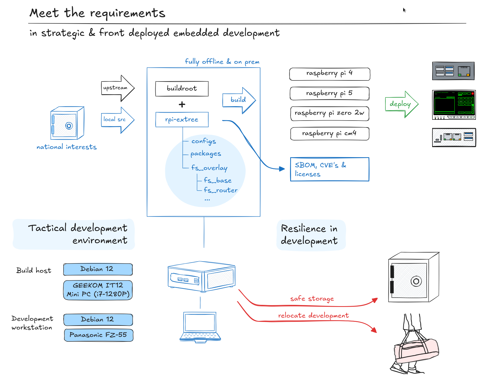

# External Buildroot Tree for Raspberry Pi

`rpi-extree` is a shared Buildroot external tree for EdgeMap, Link, and related Raspberry Pi projects. It brings board configurations and image customizations into one repository so you can select a target and build its image using a common setup.

The project is a work in progress. Its configurations use the Raspberry Pi Linux kernel tree for board support and kernel updates.

## Front-Deployed Development

You can build and deploy images from a field site while keeping the source code and build environment under your control. A portable setup makes it easier to keep development assets physically secure and resume work elsewhere if conditions at the site change.



### Equipment and operating system

- [Geekom Mini IT12 build host](https://www.geekompc.com/geekom-mini-it12-mini-pc/)
- [Panasonic Toughbook FZ-55 development laptop](https://ruggedbooks.com/products/toughbook-fz-55-mk3-intel-core-i5-1345u-14-hd-16gb-512gb-ssd-windows-11-pro)
- [Debian](https://www.debian.org/distrib/)

## Buildroot

Before building an image, install the required packages on your build host. See the [Buildroot manual](https://buildroot.org/downloads/manual/manual.html) for host requirements.

In my tests, cross-compiling a Raspberry Pi 5 image took nearly four hours on a laptop with an Intel Core i5-8365U. A dedicated build host with a faster CPU, more RAM, and fast storage can cut that time significantly.

The project uses these Buildroot configurations as starting points.

```text
raspberrypi4_64_defconfig
raspberrypi5_defconfig
raspberrypicm4io_64_defconfig
raspberrypizero2w_64_defconfig
```

## Available configurations

Since early 2026, `rpi-extree` has expanded to cover more hardware and use cases. Some configurations are maintained for regular use. Others support experiments and early development.

| Defconfig | Description |
| --- | --- |
| `raspberrypi4_pocketterm_ab_defconfig` | [Link for the Waveshare PocketTerm 3.5](doc/pocketterm.md) with SWUpdate support |
| `raspberrypi4_edgemap_lite_ab_defconfig` | EdgeMap Lite for Raspberry Pi 4, which replaces the original EdgeMap configuration |
| `raspberrypi4_reterminal_ab_defconfig` | Link for reTerminal with SWUpdate support |
| `rpi5_offline_pxe_defconfig` | Offline PXE boot server for Debian installation on a Raspberry Pi 5 |

The [`configs/`](configs/) directory also contains older variants and configurations used occasionally.
